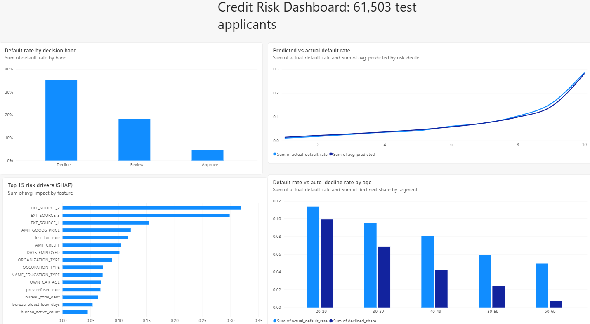

# Credit Risk & Loan Default Prediction

I built a model that estimates how likely a loan applicant is to have trouble repaying, explains each decision in plain English, and writes a short credit memo with AI. Then I checked two things most projects skip: whether the AI makes things up, and whether the model treats age groups fairly.

**Live app:** https://credit-risk-rajavinay.streamlit.app



## Why this project

Lenders lose money when borrowers don't repay. They also lose business when they turn good customers away. I wanted to see how far a model could improve that trade-off, and what it costs in fairness.

## Data

[Home Credit Default Risk](https://www.kaggle.com/competitions/home-credit-default-risk) (Kaggle): 307,511 past loan applications with outcomes, plus 7 history tables, about 58 million rows in total. 8.07% of applicants had payment difficulties.

The data is not in this repo because Kaggle's rules don't allow sharing it. Download it from Kaggle and put the CSV files in a `data/` folder.

## What I did

1. **Profiled all 8 tables with DuckDB (SQL)** to stay within 16 GB of RAM.
2. **Found data problems.** 55,374 applicants had an impossible employment value (365,243 days, about 1,000 years). Almost all were pensioners, so I flagged them instead of deleting 18% of the data. One applicant reported an income of 117 million with a small loan, likely an entry error.
3. **Turned about 17 million history rows into 17 features per applicant** with SQL: late-payment rate, refusal rate, debt with other lenders. I checked that none of them used information from after the application date.
4. **Tested patterns with statistics** (chi-square, Mann-Whitney U). With 300,000 rows almost everything is significant, so I focused on how big the differences were.
5. **Trained a Logistic Regression baseline**, then LightGBM.
6. **Explained predictions with SHAP** and checked fairness by gender and age.
7. **Chose approve, review and decline cut-offs.**
8. **Built an AI credit memo with Gemini** and tested it for invented facts.
9. **Built a Power BI dashboard and a Streamlit app.**

## Results

Measured on 61,503 test applicants the models never saw during training.

| | Logistic Regression (baseline) | LightGBM |
|---|---|---|
| ROC-AUC | 0.7525 | **0.7708** |
| PR-AUC (random guessing = 0.0807) | 0.2304 | **0.2571** |
| Brier score (lower is better) | 0.0683 | **0.0671** |

- LightGBM beat the baseline in all 200 bootstrap resamples (95% range: +0.015 to +0.022 AUC).
- Predicted and actual default rates stayed within 1.3 points in every risk decile, so the probabilities can be trusted for loss estimates.
- 5 of my 17 SQL features made the top 15 drivers. Late-payment rate ranked 5th.

## Choosing a cut-off

Instead of a yes/no rule, I used three bands:

| Band | Rule | Share of applicants | Default rate |
|---|---|---|---|
| Approve | risk under 12% | 81.1% | 4.69% |
| Human review | 12% to 25% | 13.9% | 18.13% |
| Decline | 25% or more | 5.0% | 35.18% |

The default rate among approved loans falls from 8.07% to 4.69%.

## Fairness

- **Gender is not a model input**, yet men who repaid were flagged 1.5x more often than women who repaid (21.9% vs 14.5%, flagging the riskiest 20%). Other columns act as proxies.
- **Age:** a single cut-off turned a 2.3x real risk gap into a 6x gap in good payers being flagged.
- **I tried removing age.** AUC barely moved (0.7708 to 0.7695) and the 6x gap stayed, because employment history carries age anyway.
- **With the three bands**, good payers aged 20 to 29 who get auto-declined fell from 31.6% to 7.5%. Most go to a human instead. The relative gap still exists, so reviewers should keep watching it.

## AI credit memo

For each applicant, Gemini receives a small fact sheet (risk, band, loan, income, top reasons) and is told to use nothing else.

Tested on 20 applicants (19 memos; one hit the free-tier limit):
- Recommendation matched the model: 19 of 19
- Memos with a number not in the fact sheet: 0 of 19
- Manual read of 3 memos: no invented claims

Zero errors in 19 does not prove the AI never invents. A rough 95% upper bound is 3/19, about 16%. One memo also mentioned marital status, so the app now hides age, gender and marital status from all explanations. The app re-runs the number check on every memo it writes.

## Limitations

- I picked the 12% and 25% cut-offs by looking at test results. A real rollout should set them on separate data.
- The three strongest features are external scores whose meaning isn't disclosed.
- I skipped three history tables (POS cash, credit card, bureau balance).
- The app fills inputs you don't change with typical values. It is a demo, not a real scoring tool.
- The memo test is small because of free-tier limits.

## Notebooks

| Notebook | What it covers |
|---|---|
| 01_understand_data | Table sizes, keys, target imbalance |
| 02_data_quality | Missing values, placeholder codes |
| 03_sql_history | SQL features from history tables |
| 04_analysis | Statistical tests |
| 05_baseline_model | Train/test split, cleaning, Logistic Regression |
| 06_lightgbm | LightGBM, bootstrap test, calibration |
| 07_explain_fairness | SHAP and fairness checks |
| 08_business_cutoff | Cut-off trade-offs, three bands |
| 09_credit_memo | Gemini memo and invented-fact test |
| 10_dashboard_data | Summary tables for Power BI |
| 11_app_prep | Typical values for the app |

## Run it yourself

```bash
pip install -r requirements.txt
python -m streamlit run app.py
```

The AI memo needs a Gemini API key in a `.env` file (`GEMINI_API_KEY=...`). Everything else works without it.

## Tools

Python, DuckDB (SQL), pandas, scikit-learn, LightGBM, SciPy, SHAP values, Power BI, Gemini, Streamlit